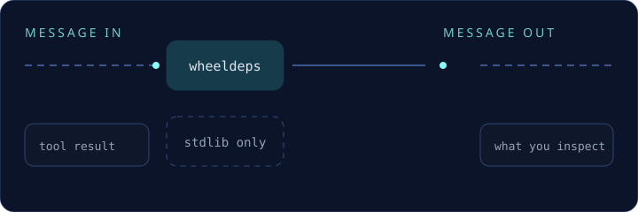

<p align="center">
  
</p>

<p align="center">
  <a href="https://pypi.org/project/wheeldeps/"></a>
  <a href="https://pypi.org/project/wheeldeps/"></a>
  <a href="https://pypi.org/project/wheeldeps/"></a>
  <a href="https://github.com/sandeshbagmare/wheeldeps/actions/workflows/ci.yml"></a>
  <a href="https://github.com/sandeshbagmare/wheeldeps/blob/main/LICENSE"></a>
  <a href="https://sandeshbagmare.github.io/wheeldeps/"></a>
  <a href="https://pypi.org/project/wheeldeps/"></a>
</p>

<h3 align="center">read a wheel&#x27;s dependencies offline, markers included</h3>
<p align="center"><em>Standard library only. No runtime dependencies. Python 3.9+.</em></p>

<p align="center">
  
</p>

## Install

```console
pip install wheeldeps
```

## Use

```console
wheeldeps *.whl                                   # what is missing
wheeldeps *.whl --json                            # machine readable
wheeldeps *.whl --python-version 3.10             # evaluate markers for another Python
wheeldeps *.whl --platform win32                  # ... and another platform
wheeldeps *.whl --closure mypackage               # what mypackage pulls from this set
```

```python
from wheeldeps import external_requirements, read_wheels

wheels = read_wheels(["app-1.0-py3-none-any.whl", "lib-2.0-py3-none-any.whl"])
for requirement in external_requirements(wheels):
    print(requirement.name, requirement.specifier, requirement.marker)
```

## What it does properly

- **Name normalisation** — `Zope.Interface`, `zope_interface` and `zope-interface` are
  the same project (PEP 503), so a provided wheel is recognised however it is spelled.
- **Environment markers** — `sys_platform == "win32"`, `python_version >= "3.9"`,
  `extra == "socks"`, `and`/`or`/`not`, parentheses, `in` / `not in`. Version
  comparisons are numeric, so `"3.12" > "3.9"` behaves (a string compare gets it wrong).
  Point it at another interpreter with `--python-version` / `--platform`.
- **Closure** — `--closure NAME` walks the requirement graph inside the set, so you can
  see which wheels one package really drags in.
- **No extraction** — the METADATA member is read straight out of the zip, so a wheel
  cannot write anything to disk while being inspected.

## What it does not do

- It does not download, resolve version conflicts, or choose between candidates: it
  answers "does this set satisfy these requirements", using names only.
- Specifiers are reported, not enforced (an installed `requests 1.0` still counts as
  providing `requests>=2`). Check the versions with `pip check` if that matters.
- Extras are parsed and kept, but a requirement on `requests[socks]` is treated as a
  requirement on `requests`, which is what a bundle needs.

## Development

```console
python -m venv .venv
.venv/bin/pip install -e ".[test]"
.venv/bin/pytest
```

The suite covers every line of the package (`pytest --cov --cov-branch`), and the
examples in the docstrings run as tests through `--doctest-modules`.

## License

MIT.
